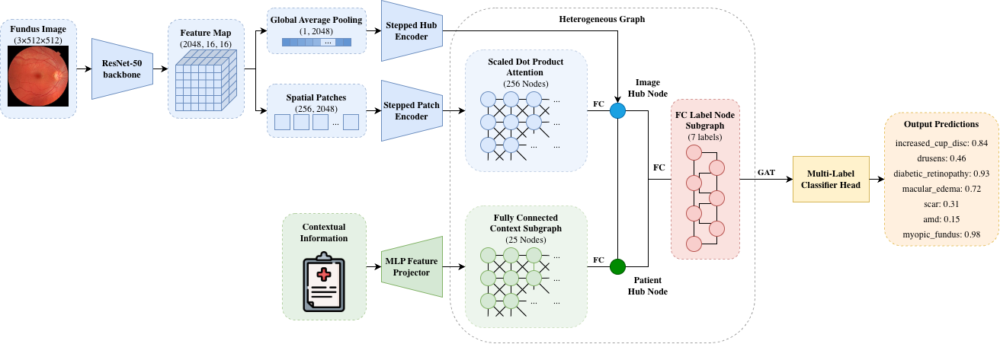

# Dual-Hub Heterogeneous Graph Attention for Multimodal Multi-Label Retinal Screening

Official repository for the paper "Dual-Hub Heterogeneous Graph Attention for Multimodal Multi-Label Retinal Screening".

---

## Architecture Overview



The framework models each patient examination as a heterogeneous attributed graph:
- **Patch Nodes**: $16 \times 16$ spatial grid ($M=256$) local lesion representations with Gaussian distance attention bias (accelerated via FlashAttention SDPA).
- **Image Hub Node**: Visual aggregator per photograph with eye laterality embedding.
- **Patient Hub Node**: Global individual descriptor aggregating tabular context (demographics and systemic comorbidities).
- **Condition Label Nodes**: Learnable disease prototypes with empirical disease co-occurrence clique edges and dual-hub vision-context routing.

---

## Experimental Pipeline (4 Core Steps)

### Step 1: Dataset Preparation with Patient-Level Stratification
Prepares the BRSET dataset into train, validation, and evaluation splits using iterative multilabel patient-level stratification to ensure zero patient data leakage:

```bash
# Resize images to 512x512
python resize_dataset.py --input-dir data/BRSET/fundus_photos --output-dir data/BRSET/fundus_photos_512 --size 512

# Generate patient-stratified splits across random seeds (e.g. 42, 12, 3)
python generate_splits.py --root data/BRSET --split-basis patient --seed 42
python generate_splits.py --root data/BRSET --split-basis patient --seed 12
python generate_splits.py --root data/BRSET --split-basis patient --seed 3
```

---

### Step 2: Hyperparameter Tuning
Performs full grid search ($3 \times 3 = 9$ configurations: hidden dimensions $\{128, 256, 512\} \times$ dropouts $\{0.15, 0.25, 0.35\}$) on image-only models across:
1. **Multilabel** (all 7 conditions simultaneously)
2. **Diabetic Retinopathy** (middle-prevalence single-label)
3. **Myopic Fundus** (low-prevalence single-label)

```bash
# Cluster job array (Array 0-8 for all 9 configurations in parallel)
sbatch submit_hparam_tuning.sh 42
```
*Results*:
- High/Middle-prevalence targets and Multilabel converge to **512 hidden, 0.15 dropout**.
- Low-prevalence targets (`myopic_fundus`, `drusens`) converge to **128 hidden, 0.25 dropout**.

---

### Step 3: Hyperparameter Checking on Remaining Single-Label Models
Performs head-to-head comparison between the two winning configurations (512h/0.15d vs 128h/0.25d) on the remaining 5 single labels:
- Glaucoma / Increased Cup-to-Disc (`increased_cup_disc`)
- Drusen (`drusens`)
- Macular Edema (`macular_edema`)
- Chorioretinal Scar (`scar`)
- Age-Related Macular Degeneration (`amd`)

```bash
# Run head-to-head check on cluster
sbatch submit_final_sweep.sh 42
```

---

### Step 4: Final Training Across 3 Different Seeds
Trains all **24 models** (7 single-label targets + 1 multilabel target across 3 modalities: `ctx_only`, `image_only`, `img_ctx`):
- **Training Duration**: 150 epochs.
- **Checkpointing**: Highest AUPRC (single-label) or Macro-AUPRC (multilabel) on validation split.
- **Threshold Calibration**: Optimal decision threshold $\tau^* \in [0.001, 0.999]$ in increments of $0.001$ maximizing $F_1$ / Macro-$F_1$ on validation data.
- **Evaluation Outputs**: Per-label AUPRC, AUROC, F1, Accuracy, Balanced Accuracy, Precision, and Recall on the held-out test split.

#### Execution Distribution
- **Local Tier** (3 models): `myopic_fundus` (`ctx_only`, `image_only`, `img_ctx`)
- **Cluster Tier** (21 models): `drusens` + 5 singlelabels + `multilabel` across 3 modalities

```bash
# 1. Local Training (e.g. for Seeds 42, 12, 3)
python train_final_models.py --root "data/BRSET" --seed 42 --tier local
python train_final_models.py --root "data/BRSET" --seed 12 --tier local
python train_final_models.py --root "data/BRSET" --seed 3 --tier local

# 2. Cluster Training (21 jobs in parallel per seed via SLURM Array 0-20)
sbatch submit_final_models.sh 42
sbatch submit_final_models.sh 12
sbatch submit_final_models.sh 3
```

---

## Repository Structure

```
.
├── generate_splits.py              # Step 1: Patient-level stratification generator
├── resize_dataset.py               # Step 1: 512x512 image preprocessor
├── tune_hyperparams.py             # Step 2: 9-config hyperparameter tuning
├── submit_hparam_tuning.sh         # Step 2: SLURM job array for tuning
├── sweep_remaining_singlelabels.py # Step 3: Head-to-head check on remaining 5 singlelabels
├── submit_final_sweep.sh           # Step 3: SLURM job array for head-to-head sweep
├── train_final_models.py           # Step 4: Final training orchestrator across 24 models
├── submit_final_models.sh          # Step 4: SLURM job array for cluster models (Array 0-20)
├── gnn/
│   ├── __init__.py
│   └── patientgraphmodel.py        # Heterogeneous Patient Graph Architecture (SDPA + Dual-Hub)
├── data_functions/
│   ├── __init__.py
│   ├── BRSETDataSplitter.py        # Multilabel stratified patient splitter
│   ├── BRSETGraphDataset.py        # Graph dataset constructor with clinical comorbidities
│   └── BRSETImageDataset.py        # Image dataset constructor
├── utils/                          # Shared training, metric, logging, and feature utilities
├── method.tex                      # Paper methodology section
├── arch_diagram.tex                # Paper TikZ architecture diagram
├── environment.yml                 # Conda environment definition
└── requirements.txt                # Python dependencies
```

---

## Environment Setup

```bash
conda env create -f environment.yml
conda activate brset-camlc
# or
pip install -r requirements.txt
```
